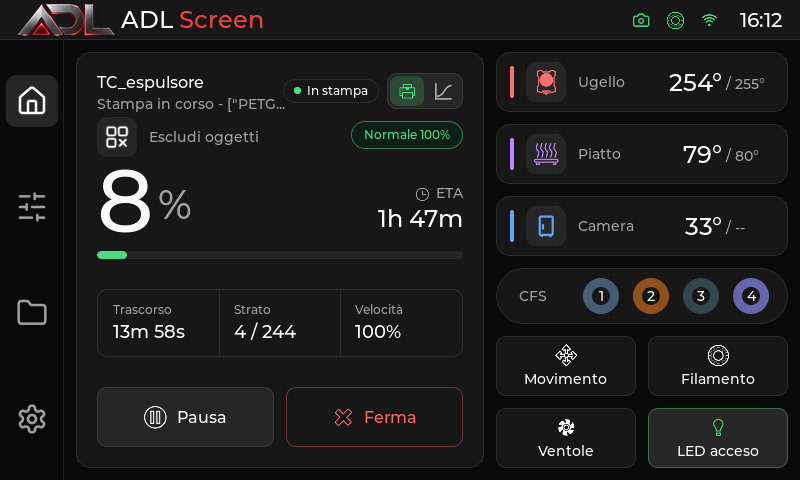
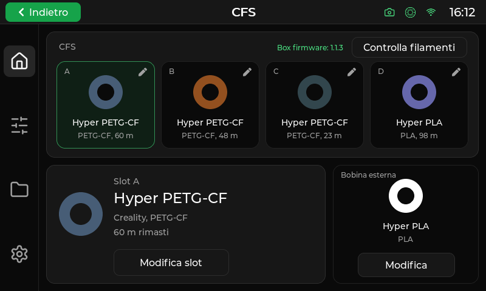
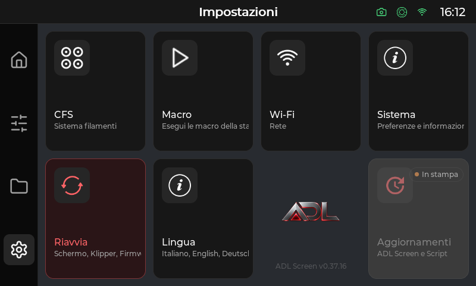

# ADL_Screen

Il pannello touch per gestire stampe, CFS e bobina esterna sulla Creality K1C.

## A chi serve

ADL_Screen è destinato a chi usa una **Creality K1C con CFS, accesso root, Klipper e Moonraker** e vuole controllare la stampante dal display originale. Sostituisce l'interfaccia Creality e riunisce scelta del filamento, avvio dei file, temperature, movimento, regolazioni e manutenzione.

È utile quando si alternano CFS e bobina esterna, si cambia filamento durante una pausa o si interviene sulla macchina mentre si è davanti alla stampante. Il vantaggio pratico è avere sul touch operazioni che altrimenti richiedono l'interfaccia web o l'invio manuale di comandi e macro. Il pannello usa le funzioni di Klipper e le macro installate: non sostituisce lo slicer e non aggiunge da solo le funzioni mancanti nel firmware.

## Compatibilità e stato

La configurazione dichiarata dall'autore è **Creality K1C con firmware CFS**, provato dall'autore su `2.3.5.34`, accesso root e schermo originale. Non sono dichiarate distribuzioni per altre stampanti, Android o Raspberry Pi.

Il README dell'autore indica il canale **nightly**, con versioni preliminari. Le note `v0.37.0` presenti nel progetto non identificano con certezza una versione corrente della distribuzione ADL_Screen.

## Funzioni principali

| Funzione | Utilità e limiti |
| --- | --- |
| CFS e bobina esterna | Consulta i quattro slot, materiale, colore e metri residui comunicati dal CFS. Modifica materiale e colore e registra quelli della bobina esterna. La scelta CFS/bobina esterna appare all'avvio quando il CFS risulta collegato. |
| Avvio della stampa | Scegli un G-code locale o su USB e avvialo dal display. Quando le relative macro sono disponibili puoi scegliere mesh disattivata, adattiva o completa e attivare lo spurgo adattivo. |
| Controllo del lavoro | Segui avanzamento, tempi, temperature e dati disponibili del file; metti in pausa, riprendi o interrompi. L'esclusione di un singolo oggetto richiede oggetti etichettati nel G-code. |
| Gestione filamento | Carica la bobina esterna, ritira il filamento, estrudi o ritrai una quantità in millimetri e spegni l'ugello. Il cambio manuale dedicato compare durante la pausa. |
| Regolazioni e comandi macchina | Regola velocità, flusso, offset Z e Pressure Advance; gestisci movimento, home, motori, ventole e LED. La camera richiede le macro di controllo previste. |
| Calibrazioni | Accedi a mesh del piatto e profili, Input Shaper, analisi delle cinghie e PID. I comandi richiedono hardware, moduli e macro compatibili; i salvataggi con `SAVE_CONFIG` riavviano Klipper. |
| File e lavori precedenti | Ordina ed elimina file, consulta gli ultimi 30 lavori restituiti dalla cronologia e ristampa quelli ancora disponibili. Consulta i timelapse, copiali su USB o eliminali; il pannello non riproduce video. |
| Console e macro | Invia G-code, consulta le risposte ed esegui macro, anche con parametri. Le macro disponibili dipendono dalla configurazione della stampante. |
| Impostazioni e strumenti opzionali | Scegli tra italiano, inglese, tedesco, francese e spagnolo; gestisci Wi-Fi e informazioni di sistema. Spoolman, strumenti TMC e dispositivi di alimentazione dipendono dai servizi rilevati. |

I codici materiale CFS con prefisso `1`, come `106003`, vengono ricondotti al catalogo quando esiste una corrispondenza: questo evita di mostrare soltanto un codice al posto del nome del materiale.

## Installazione

### Requisiti

- K1C con firmware CFS, root e display originale.
- SSH attivo, indirizzo IP della stampante e password di root.
- Klipper e Moonraker installati e funzionanti.
- Connessione di rete e accesso a Internet dalla stampante per il download e gli aggiornamenti.
- [ADL Script](https://github.com/AlbertoTrento/ADL-Script), con le macro necessarie alle operazioni descritte sotto.

Installare solo a macchina inattiva: nessuna stampa, riscaldamento, home o calibrazione in corso.

### Preparare ADL Script

Dal menu di ADL Script installare almeno:

```text
[Install] Menu > 6) Install Power Macros
[Install] Menu > 8) Install Klipper Adaptive Meshing & Purging
```

**Carica filamento** richiama `_CARICA_BOBINA_ESTERNA TEMP=...`. Il README dell'autore colloca questa macro in `files/kamp/Start_Print.cfg` di ADL Script e attribuisce alle Power Macros in `files/power-config/gcode_macro.cfg` il ripristino del CFS a fine stampa. Senza queste integrazioni il pannello può aprirsi, ma le operazioni dipendenti dalle macro non sono complete.

### Effetti dell'installazione

Secondo le istruzioni dell'autore, l'installatore disattiva lo schermo Creality (`Monitor`, `display-server`), Creality Cloud, il collegamento LAN di Creality Print e gli aggiornamenti firmware OTA. Mostra un avviso e chiede conferma prima di procedere.

L'installatore e lo script di ripristino non sono inclusi nei materiali locali disponibili: le procedure seguenti conservano le istruzioni dell'autore e non sono state eseguite né verificate tramite rete.

### Metodo A: menu di ADL Script

Installare e aprire ADL Script seguendo la sua documentazione, quindi scegliere:

```text
[Customize & PowerScreen] Menu > 1) Install PowerScreen
```

Leggere l'avviso, confermare e selezionare `nightly`, il canale indicato nel README dell'autore.

### Metodo B: installatore diretto

Collegarsi in SSH sostituendo il segnaposto con l'indirizzo della K1C:

```sh
ssh root@IP_DELLA_TUA_K1C
```

Scaricare ed eseguire l'installatore indicato dall'autore:

```sh
wget --no-check-certificate -O /tmp/powerscreen-installer.sh https://raw.githubusercontent.com/AlbertoTrento/ADL-Screen/main/installer.sh
sh /tmp/powerscreen-installer.sh nightly
```

Secondo il README originale, l'installatore scarica `powerscreen-k1c.tar.gz` dalle [Release ADL-Screen](https://github.com/AlbertoTrento/ADL-Screen/releases), installa in `/usr/data/powerscreen`, conserva gli originali Creality in `/usr/data/powerscreen-backup`, configura servizio, moduli e macro, registra l'aggiornamento in Moonraker e riavvia Klipper e pannello. Questi sono comportamenti documentati dell'installatore, non operazioni svolte durante questa preparazione editoriale.

I nomi interni `powerscreen`, `powerscreen-k1c.tar.gz` e `/usr/data/powerscreen` restano quelli usati dalle procedure esistenti.

## Uso

### Preparare e avviare un file

1. Preparare il G-code con lo slicer e renderlo disponibile a Moonraker, per esempio caricandolo da Fluidd, oppure usare una chiavetta USB riconosciuta dalla stampante.
2. Aprire la pagina dei file, scegliere **Local** o **USB**, aggiornare l'elenco e selezionare il file.
3. Premere **Stampa**. Se disponibili, scegliere mesh, spurgo adattivo e alimentazione **CFS** o **Bobina esterna**.
4. Per la bobina esterna, inserire prima il filamento fino all'estrusore. Il caricamento e lo spurgo automatici descritti dall'autore dipendono dalle macro ADL Script.
5. Confermare **Avvia** e seguire lo stato del lavoro.

Il pannello imposta la sorgente tramite `BOX_ENABLE_CFS_PRINT ENABLE=0` per la bobina esterna o `ENABLE=1` per il CFS. Le opzioni di mesh e spurgo appaiono solo se vengono rilevati i rispettivi elementi di configurazione.

### Gestire CFS e filamento

Nella pagina CFS scegliere uno dei quattro slot, leggere i dettagli e usare **Modifica slot** per materiale e colore. **Controlla filamenti** richiede una rilettura al CFS. La casella **Bobina esterna** permette di salvare materiale e colore nelle impostazioni del pannello; non costituisce una misura automatica della bobina esterna.

Nella pagina Filamento impostare una temperatura adatta al materiale. **Carica filamento** usa la macro di caricamento e, quando necessario, propone prima l'home. **Togli filamento** riscalda, ritrae 100 mm e spegne l'ugello. **Carica mm** e **Scarica mm** usano lunghezza e velocità selezionate. **Spegni ugello** azzera il target dell'estrusore.

### Pausa e cambio manuale

Durante una pausa è disponibile il cambio manuale. Il progetto documenta il flusso con `M600`; la finestra manuale usa `PS_RESUME` e `PS_CANCEL`, mentre la schermata di stato richiama `PS_RESUME_PRINT` per riprendere.

**Dopo il caricamento manuale l'ugello può rimanere nella vaschetta di spurgo.** Le istruzioni dell'autore avvertono che il `RESUME` di fabbrica può rientrare diagonalmente e urtare la spazzola. Usare il tasto di ripresa del pannello o `PS_RESUME_PRINT`; non inviare un semplice `RESUME` da Fluidd o console mentre l'ugello è nella vaschetta. Il movimento effettivo dipende dalle macro installate.

### Regolazioni, calibrazioni e strumenti

Dalla pagina di regolazione intervenire su offset Z, velocità, flusso e Pressure Advance. I controlli di movimento consentono home, spostamenti per distanza e disattivazione dei motori. Usare ventole, LED e camera secondo i dispositivi e le macro disponibili.

Per la manutenzione aprire la funzione desiderata: **Bed Mesh** mostra la superficie e gestisce i profili; **Input Shaper** esegue misure sugli assi e permette di salvare i parametri; **Belts / Shake** offre analisi ed eccitazione delle cinghie; **PID Tune** calibra ugello o piatto alla temperatura scelta. Le operazioni con `SAVE_CONFIG` comportano il riavvio di Klipper. Pulizia ugello, TMC e alimentazione compaiono secondo le integrazioni rilevate.

La console invia comandi alla stampante e mostra le risposte; la pagina macro permette di selezionare una macro e compilare gli eventuali parametri.

### Cronologia, timelapse e lingua

**History** mostra i lavori recenti e permette di ristampare un file ancora disponibile. L'azzeramento dei totali non cancella l'elenco dei lavori. **Timelapse** elenca i video prodotti dal modulo dedicato: è possibile copiarli su USB o eliminarli, ma per guardarli occorre aprirli da Fluidd o da un altro dispositivo.

Da **Impostazioni > Lingua** scegliere italiano, inglese, tedesco, francese o spagnolo. L'italiano è il valore predefinito; la scelta viene salvata e il pannello viene riavviato per applicarla.

## Aggiornamento e rimozione

Il README dell'autore indica l'aggiornamento dal pannello, in **Impostazioni > Aggiornamenti**; nei sorgenti il pulsante è denominato **Power Update**. In alternativa, usare **Settings > Software Updates** in Fluidd, con la registrazione Moonraker prevista dall'installazione. Il pannello disabilita l'accesso all'aggiornamento quando rileva la macchina occupata in stampa.

Per rimuovere ADL_Screen, la procedura documentata è:

```text
[Customize & PowerScreen] Menu > 2) Remove PowerScreen
```

Oppure, da SSH:

```sh
sh /usr/data/powerscreen/reinstall-creality.sh
```

Secondo l'autore questa procedura ripristina schermo e servizi Creality. Dopo la rimozione è consigliato riavviare la stampante.

## Schermate

I riferimenti seguenti conservano i percorsi del manifesto. Le immagini non sono state ispezionate e non vengono attribuite loro funzioni specifiche.

| Riferimento | Immagine |
| --- | --- |
| Schermata 1 |  |
| Schermata 2 |  |
| Schermata 3 |  |

## Crediti e licenze

ADL_Screen è una versione modificata di [PowerScreen](https://github.com/borferkic/K1C-CFS-POWER-SCREEN) di Boris Fernández (Boris SdK), mantenuta da Alberto (AlbertoTrento) dal 6 novembre 2026. PowerScreen deriva da [GuppyScreen](https://github.com/ballaswag/guppyscreen) di ballaswag.

- **Codice:** GNU GPL-3.0, come dichiarato dal progetto; il riferimento originale è [LICENSE](LICENSE), non presente nei materiali locali disponibili.
- **PowerUI:** [CC BY-NC 4.0](https://creativecommons.org/licenses/by-nc/4.0/), con attribuzione a Boris Fernández, collegamento alla licenza e indicazione delle modifiche. L'uso commerciale richiede il permesso dell'autore. Vedere [LICENSE-POWERUI.md](LICENSE-POWERUI.md).
- PowerUI si basa su shadcn/ui; ulteriori attribuzioni, comprese Lucide, Z-Bolt e LVGL, sono conservate in [NOTICE.md](NOTICE.md).

## Ambito della preparazione editoriale

Testi rielaborati dal README, dalle note e licenze disponibili e dai sorgenti pertinenti. Non sono stati eseguiti test, installazioni, compilazioni, accessi di rete o prove sulla stampante. Le istruzioni degli installer esterni e delle macro ADL Script sono riportate come informazioni dell'autore, senza attestazione del loro funzionamento in questa esecuzione.
